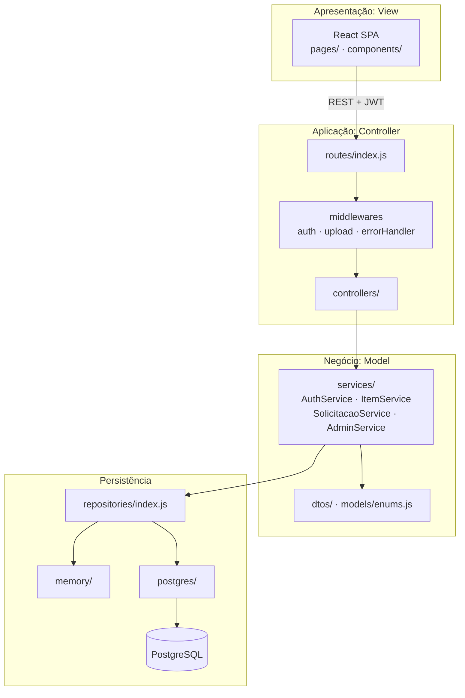

# Arquitetura aplicada

Implementa o que foi definido na seção 6 do documento do projeto.

## Camadas

Cada camada só conhece a camada imediatamente abaixo:

- **Controllers** não têm regra de negócio: só leem `req` e chamam um service.
- **Services** não conhecem Express nem SQL: recebem dados e lançam `AppError` com o status HTTP.
- **Repositories** escondem o banco. Trocar `DB_DRIVER` de `memory` para `postgres` não altera nenhuma outra linha.

## Padrões

| Padrão | Onde |
|---|---|
| MVC | `pages/` (View) · `controllers/` (Controller) · `services/` + `models/` (Model) |
| Repository / DAO | `repositories/memory/*` e `repositories/postgres/*`, com a mesma interface |
| DTO | `dtos/*`: valida a entrada (`parseX`) e define a saída (`toResponse`, sem `senhaHash`) |
| Injeção de dependência | `container.js` monta tudo; os testes injetam banco em memória e storage falso |
| Strategy | `StorageService`: disco local hoje, S3/Cloudinary depois, sem mudar o `ItemService` |

## Decisões tomadas nesta sprint

1. **Driver em memória**: permite rodar e testar sem instalar PostgreSQL. Também é o banco usado nos testes, que por isso rodam rápido.
2. **Usuário recarregado a cada requisição**: o JWT guarda só o `id`. O middleware busca o usuário no banco, então uma aprovação do admin vale imediatamente, sem novo login.
3. **Aceite transacional**: aceitar uma solicitação altera 3 registros (solicitação, item e as demais solicitações). No PostgreSQL isso roda em `BEGIN/COMMIT`.
4. **Regra de duplicidade também no banco**: índice único parcial `uq_solicitacao_pendente` garante o UC05/FA02 mesmo com requisições simultâneas.
5. **Pessoa física é aprovada automaticamente; ONG fica `PENDENTE`**: segue o texto do UC13 ("especialmente pessoas jurídicas/ONGs").
